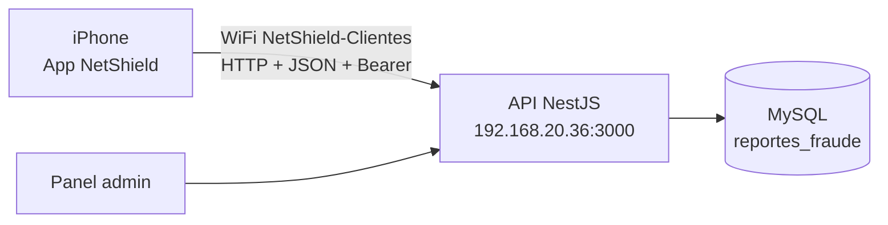
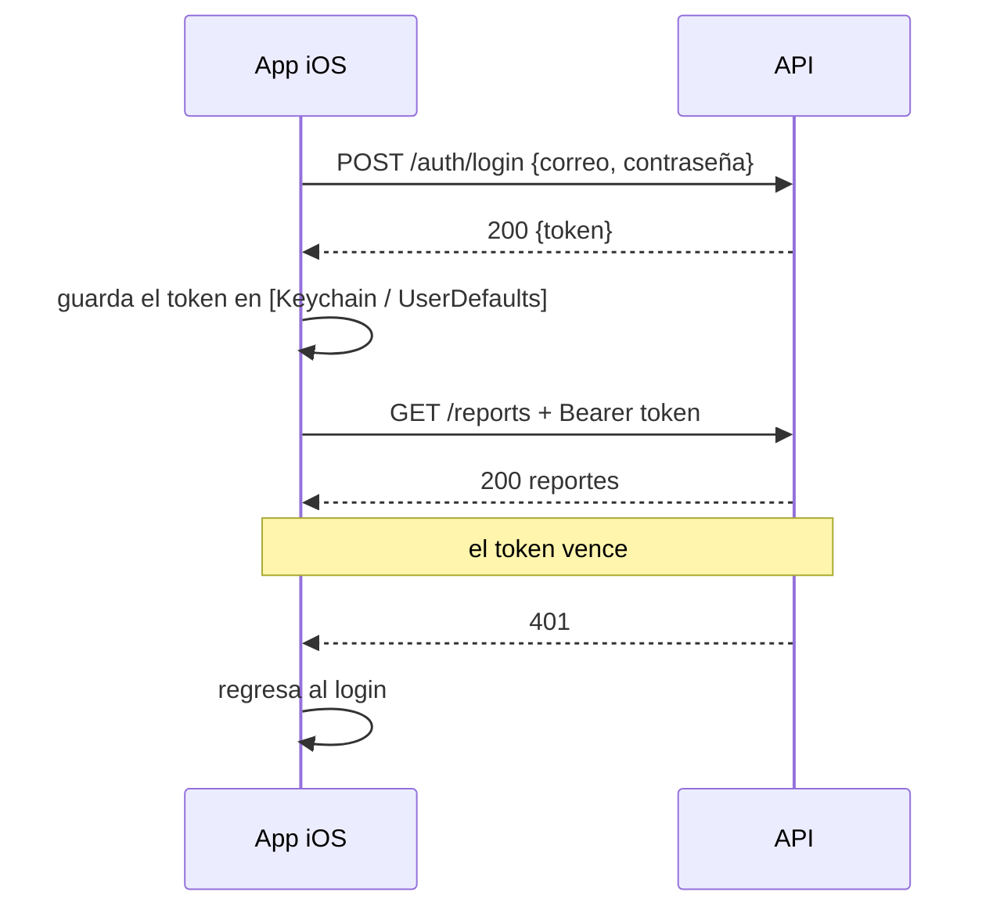

# NetShield — App iOS

**Versión:** [1.0] · **Fecha:** 2026-10-21 · **Equipo:** Flor Blacina Rodríguez Hernández, Ximena Itzel Camacho Flore, José Leonardo Salinas Ramirez, Randy Angelo Rosas Tolentino


## 1. Resumen

App nativa para iPhone con la que los usuarios reportan sitios de phishing, consultan si una URL ya fue reportada y ven las alertas publicadas por la comunidad. Está hecha en SwiftUI y se comunica con la API REST de NetShield a través de la red local del proyecto (WiFi `NetShield-Clientes`), sin depender de internet. Los reportes los revisa un administrador desde el panel web.

## 2. Arquitectura



- La app **no** accede a la base de datos; todo pasa por la API.
- La dirección de la API está en `APIClient.swift` (`baseURL`).

## 3. Tecnologías y versiones

| Capa | Tecnología | Versión | Para qué |
|---|---|---|---|
| Lenguaje | Swift | [5.x / 6] | toda la app |
| Interfaz | SwiftUI | [iOS 17+] | pantallas |
| Red | URLSession | nativo | llamadas a la API |
| IDE | Xcode | [26.5] | compilar y firmar |
| Dispositivo de prueba : simulador [iPhone 17 pro] | iOS [17.x] | ejecución |
| Control de versiones | Git + GitHub | — | colaboración |

## 4. Instalación y ejecución

### 4.1 Requisitos
- Mac con Xcode [26.5] o superior
- iPhone con iOS [17] o superior (o simulador)
- La API de NetShield corriendo y alcanzable desde la red del iPhone

### 4.2 Configurar la dirección de la API
En `APIClient.swift`:

```swift
let baseURL = "http://192.168.20.36:3000"   // IP real del equipo del backend
```

Si cambia la IP del backend, hay que cambiarla aquí y volver a compilar.

### 4.3 Compilar y ejecutar
1. Abrir `[NetShield.xcodeproj]` en Xcode.
2. Elegir el simulador o el iPhone conectado como destino.
3. Presionar **Run** (⌘R).

### 4.4 Instalar en un iPhone real sin cuenta de pago
1. En Xcode: *Settings → Accounts*, agregar un Apple ID.
2. En el target de la app: *Signing & Capabilities* → activar *Automatically manage signing* y elegir el **Personal Team**.
3. Cambiar el *Bundle Identifier* a uno único (por ejemplo `com.[equipo].netshield`).
4. Conectar el iPhone, activar el **Modo desarrollador** (*Ajustes → Privacidad y seguridad*) y presionar Run.
5. En el iPhone: *Ajustes → General → VPN y gestión de dispositivos* → confiar en el desarrollador.

Limitaciones del Personal Team: la app caduca a los 7 días (hay que volver a instalarla desde Xcode) y se permiten máximo 3 apps.

### 4.5 Permisos de red local
- **Info.plist**: `NSAppTransportSecurity → NSAllowsLocalNetworking = YES` (permite HTTP a direcciones locales) y **[`NSLocalNetworkUsageDescription`]** con un texto que explique por qué la app usa la red local.
- La primera vez, iOS pide permiso de **Red local**; el usuario debe tocar *Permitir*. Si lo negó: *Ajustes → Privacidad y seguridad → Red local → NetShield*.
- El iPhone debe estar conectado al WiFi **NetShield-Clientes** **[contraseña: en el documento de infraestructura]**.

## 5. Funcionalidades

| Pantalla | Qué hace |
|---|---|
| **Login** | inicia sesión con correo y contraseña |
| **Crear cuenta** | registra un usuario nuevo |
| **Home** | resumen y accesos rápidos |
| **Nuevo reporte** | envía URL, categoría, descripción y evidencia **[opcional]** |
| **Consultar URL** | indica si una URL ya fue reportada o confirmada como fraude |
| **Alertas** | feed de reportes publicados |
| **Estadísticas** | gráficas de reportes por tipo **[y estado]** |
| **[Mis reportes]** | **[consulta, edición y eliminación de los reportes propios]** |

Paso a paso en el **Manual de usuario de la app**.

## 6. Comunicación con la API

| Acción | Llamada |
|---|---|
| Crear cuenta | `POST /auth/register` |
| Iniciar sesión | `POST /auth/login` |
| Enviar reporte | `POST /reports` (multipart si lleva evidencia) |
| Consultar URL | `GET /reports/check?url=…` **[confirmar ruta]** |
| Alertas | `GET /reports` |
| Estadísticas | `GET /stats` |

**[Ajustar a las rutas reales; ver Swagger en `http://192.168.20.36:3000/docs`.]**

Las llamadas autenticadas envían `Authorization: Bearer <token>`.

## 7. Autenticación



## 8. Seguridad

### 8.1 Decisiones tomadas

| Tema | Decisión | Por qué |
|---|---|---|
| Sesión | token Bearer en cada petición | la API valida quién es el usuario |
| Almacenamiento del token | **[Keychain]** | almacenamiento seguro del sistema |
| Red | solo se usa la red local del proyecto; ATS limitado a `NSAllowsLocalNetworking` | no se desactiva ATS para todo internet |
| Datos | la app no guarda contraseñas | solo guarda el token |
| Evidencias | solo imágenes seleccionadas por el usuario | evitar subir archivos arbitrarios |

### 8.2 Riesgos conocidos

| # | Riesgo | Impacto | Qué haría falta |
|---|---|---|---|
| 1 | Tráfico HTTP sin cifrar en la LAN | alguien en el WiFi puede leer el tráfico | HTTPS con certificado |
| 2 | La IP del servidor está escrita en el código | si cambia, hay que recompilar | pantalla o archivo de configuración |
| 3 | Token en **[UserDefaults]** si no se usa Keychain **[confirmar]** | lectura del token en un dispositivo con jailbreak | Keychain |
| 4 | Sin validación de certificados (no hay HTTPS) | suplantación del servidor en la red | HTTPS + validación |
| 5 | **[Agregar hallazgos de las pruebas de seguridad móvil (OWASP MASVS / Xcode)]** | | |

## 9. Estructura de carpetas

```
NetShield/
├── NetShieldApp.swift        # punto de entrada
├── Networking/
│   └── APIClient.swift       # baseURL, peticiones, token
├── Models/                   # Reporte, Usuario, Categoría…
├── Views/                    # Login, Registro, Home, NuevoReporte,
│                             # ConsultarURL, Alertas, Estadísticas
├── ViewModels/               # [si se usa MVVM]
├── Assets.xcassets/          # logo, colores
└── Info.plist                # permisos de red
```

**[Ajustar a la estructura real del proyecto.]**

## 10. Colaboración en el repositorio

- Ramas: **[main (estable), develop, feature/nombre-funcionalidad]**.
- Cada integrante trabaja en su rama y abre un *pull request* hacia **[develop]**.
- Mensajes de commit claros, en imperativo (por ejemplo, "Agrega pantalla de Nuevo reporte").
- **[Funcionalidades asignadas por integrante.]**

## 11. Solución de problemas

| Qué ves | Causa | Solución |
|---|---|---|
| "No se pudo conectar con el servidor" | `baseURL` incorrecta, iPhone fuera del WiFi del proyecto, o firewall en el 3000 | revisar la IP, conectarse a `NetShield-Clientes`, abrir el puerto 3000 |
| "Ocurrió un error en el servidor" | el backend no llega a MySQL | revisar la terminal del backend |
| Nunca pide permiso de red local | se negó antes | *Ajustes → Privacidad → Red local → NetShield* |
| Xcode: "Failed to register bundle identifier" | el identificador ya existe | cambiar el Bundle Identifier |
| La app deja de abrir a los 7 días | caducó la firma gratuita | volver a instalar desde Xcode |
| "Untrusted Developer" | falta confiar en el perfil | *Ajustes → General → VPN y gestión de dispositivos* |

## 12. Pendientes y mejoras

- [ ] HTTPS dentro de la LAN
- [ ] Pantalla de configuración de la IP del servidor
- [ ] Guardar el token en Keychain
- [ ] Notificaciones push **[si se desea]**
- [ ] **[Agregar los pendientes del equipo]**
